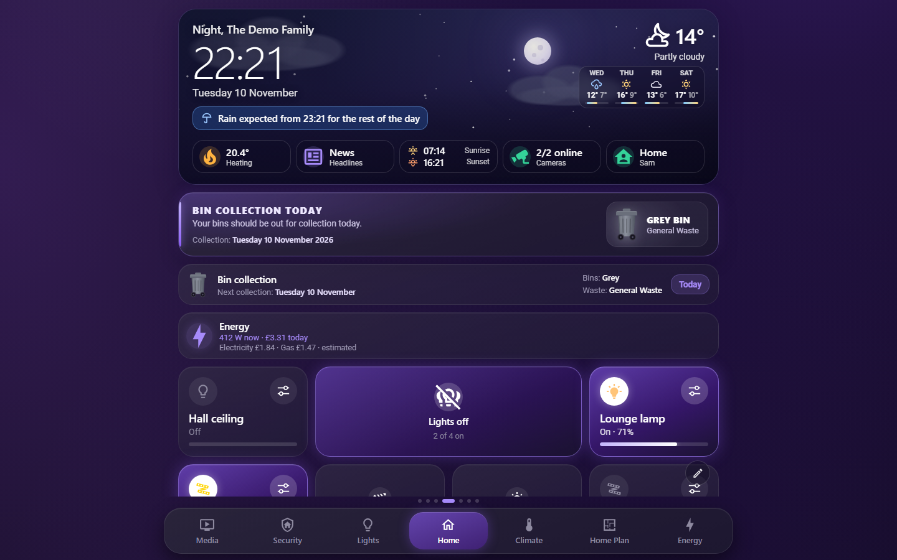
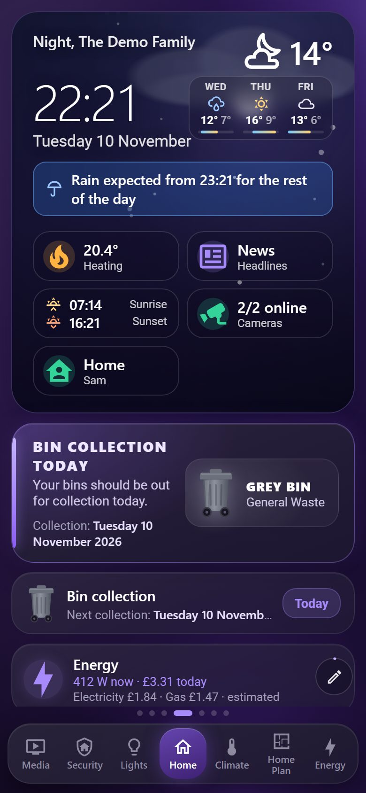
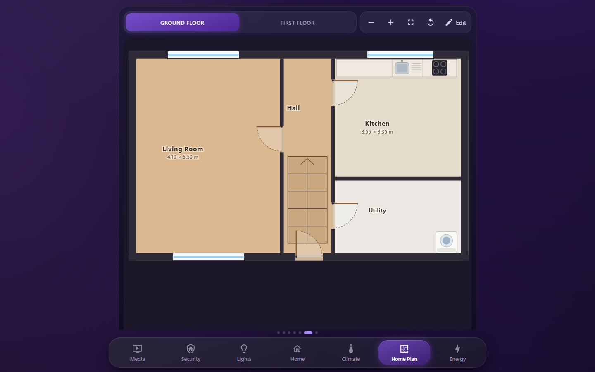
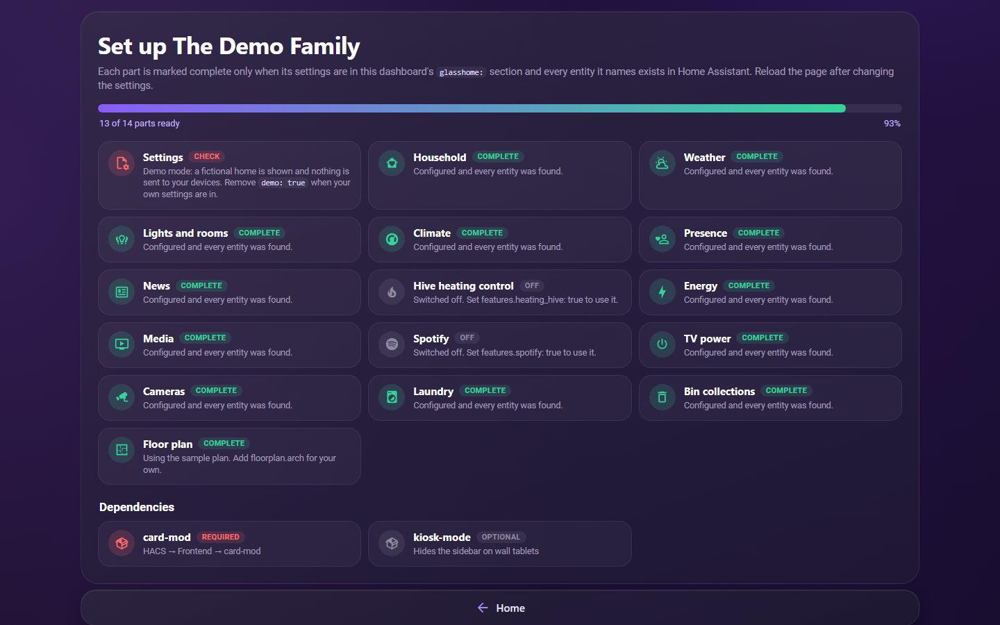

# Glass Home 2.0 (Public Beta)

> **Public beta: please read before installing.** Glass Home 2.0 has been tested with automated tests and in
> its bundled browser preview (fictional data, a stand-in for the Home Assistant frontend, 26 screen sizes). It
> has **not yet been verified on a clean, separate Home Assistant installation** or on physical phones and
> tablets. Expect rough edges, keep a backup of your Home Assistant configuration, and please report problems
> (see [Contributing](#contributing)). It installs next to your existing dashboards and changes nothing else.

A glass-style, touch-first dashboard for [Home Assistant](https://www.home-assistant.io/). It has a swipeable
homepage with a live-sky welcome panel, lighting, climate, energy, media, cameras, laundry, bin day and an
interactive floor plan. A setup wizard adapts it to your home in a few minutes without any YAML, a Settings
page changes it later, and anything you have not set up shows a tidy "Set up" box instead of a broken card.



<p align="center">
  
  &nbsp;
  
</p>

> All screenshots use the fictional demo household from `tools/preview`. None of them show a real home.

## Features

| Area | What you get | Needs |
| --- | --- | --- |
| Setup wizard | Welcome screen, then step by step: you, weather, devices, rooms, favourites, look, features. Resumes after a refresh | An administrator account to save |
| Settings page | Every choice from the wizard in tabs, plus export, import, re-run setup, clear and diagnostics | Nothing |
| Explore the demo | A complete fictional home from the welcome screen, never touching real devices | Nothing |
| Welcome panel | Greeting, 12 or 24-hour clock, animated sky that follows the real weather, forecast, status pills | Built-in weather (Open-Meteo, no key) or a `weather.*` entity |
| Lighting | Favourite lights with brightness, room switches, scenes, all on/off, schedules | Your lights / switches |
| Rooms | One glass panel per room with everything in it | Your entities |
| Climate | Thermostat, or the optional Hive heating control centre with schedules | A `climate.*` entity (Hive optional) |
| News | Headlines from public RSS feeds, saved stories shared across devices | Glass Home News integration (included) + Local To-do |
| Energy | Live demand, today's use and cost, per-appliance power | Any meter in Home Assistant (Octopus, Hildebrand Glow, clamp meters), optional |
| Media | TV state, volume, TV power with Wake-on-LAN; what's playing and your playlists from Spotify, Apple Music (through Music Assistant or Apple TV) or another music player | Android TV Remote / Spotify / Music Assistant, optional |
| Cameras | Camera tiles and a security page | Camera entities, optional |
| Laundry | Washer progress, cycle log, "finished" alert | SmartThings washer + package, optional |
| Bin day | Collection banner and reminders from your council's calendar | Calendar file or Home Assistant calendar, optional |
| Floor plan | Interactive 2D plan from your own picture or drawing: place devices, tap for controls | Nothing (sample plan built in) |
| Setup page | Checklist with a progress bar. Each item ticks only when its settings exist **and** its entities are found | Nothing |

Optional features are **off by default**. The setup wizard switches on the ones your Home Assistant can support.
Glass Home shows and controls the devices **Home Assistant** has; see [docs/integrations.md](docs/integrations.md)
for Matter, Wi-Fi, Zigbee, Z-Wave and MQTT.

## Requirements

- Home Assistant 2024.11 or newer (sections views with `grid_options`, heading cards)
- [card-mod](https://github.com/thomasloven/lovelace-card-mod) (HACS), required
- [kiosk-mode](https://github.com/NemesisRE/kiosk-mode) (HACS), optional, hides the sidebar on wall tablets

Nothing else: all Glass Home cards are in this repository.

## Install

The full guide is in [docs/install.md](docs/install.md). Download the installation ZIP from this repository's
**Releases** page (it holds only the files you install, in the same folders as below), or clone
this repository. In short:

1. Copy `www/glasshome/` to `/config/www/glasshome/` and `themes/glasshome.yaml` to `/config/themes/`. For News,
   copy `custom_components/glasshome_news/` to `/config/custom_components/`. Copy any packages you want, one file
   at a time. **The heating package controls real heating:** read
   [Heating package safety](docs/install.md#heating-package-safety) before using it.
2. Restart Home Assistant. For News, add the **Glass Home News** integration (Settings → Devices & services).
3. Add the resources (Settings → Dashboards → ⋮ → Resources, all **JavaScript module**):
   - `/local/glasshome/glasshome-cards.js?v=2.0.0`
   - `/local/glasshome/glasshome-news.js?v=2.0.0` (if you use News)
4. Add a dashboard at the URL `glass-home` and paste [dashboards/glasshome.yaml](dashboards/glasshome.yaml) into
   its raw configuration editor, deleting the `glasshome: !include config.yaml` line. A YAML-file install is also
   supported.
5. Open the dashboard. The welcome screen starts the setup wizard ([docs/setup-guide.md](docs/setup-guide.md)).

## First-time setup

The first time you open Glass Home, a welcome screen offers **Get started** or **Explore the demo**. The wizard
then walks through eight steps: you and your home, location and weather, connecting your devices, rooms,
devices, look, features and finish. It saves its progress, so a refresh does not lose your place, and checks for
problems before saving the settings into the dashboard. Everything can be changed later in **Settings** (the
last button in the bottom bar). Details: [docs/setup-guide.md](docs/setup-guide.md).

<p align="center">
  
</p>

## Connecting your devices

Glass Home shows and controls what **Home Assistant** already has: add devices to Home Assistant first (Matter,
Zigbee, Z-Wave, MQTT, Wi-Fi brands and the many other integrations), then pick them in the wizard. Glass Home
never asks for a password or key for another service. Accounts such as Spotify, energy suppliers and cameras are
connected in Home Assistant's own integration setup. The wizard's **Connect your devices** step and
[docs/integrations.md](docs/integrations.md) explain how; [docs/features.md](docs/features.md) lists which
integration each feature uses.

## Weather

Choose in the wizard's location step, or in Settings:

- **Built-in weather** from [Open-Meteo](https://open-meteo.com/): search for your town, no account or key.
  The browser sends only the chosen place, rounded to about 1 km.
- **A Home Assistant weather entity**, for example the Met.no integration that new installations include.

See [docs/configuration.md](docs/configuration.md#weather).

## Configuration

The setup wizard and Settings page write your choices for you. They all live in **one place**, the dashboard's
own `glasshome:` section, which you can also edit by hand:

```yaml
glasshome:
  household: { greeting: Sam, name: The Smiths, timezone: Europe/London, clock: 24 }
  features: { energy: true, cctv: true }
  weather: { provider: open_meteo, place: { name: Testville, latitude: 12.35, longitude: -45.68 } }  # glasshome-validate: allow
  lighting: { all: [light.living_room], lights: [light.living_room] }
  rooms:
    - { name: Living Room, icon: "mdi:sofa-outline", lights: [light.living_room], entities: [light.living_room] }
  climate: { thermostat: climate.living_room }
```

The rest of the dashboard never needs editing: it contains `[[tokens]]` that are filled in from these settings. See
[docs/configuration.md](docs/configuration.md) for every option, and [docs/features.md](docs/features.md) for
what each feature needs.

> **Private by design.** The settings are part of the dashboard configuration, which Home Assistant only gives
> to signed-in users. Nothing personal is placed in `/config/www`, which is served to anyone **without signing
> in**. Still put only entity ids and display text in the settings: never passwords, tokens, API keys, or IP or
> MAC addresses. Network details for Wake-on-LAN go in `secrets.yaml`.

## Screen sizes

The layout adapts by itself from small phones (320 px) to large monitors (2560 px), in portrait and landscape.
It was checked in the preview at 26 sizes, on every view, every Settings tab and every wizard step (see
[docs/development.md](docs/development.md)). On screens narrower than 600px the homepage **reflows at full
size**: small tiles take half the width and the page scrolls. Large monitors get a wider layout. Wall tablets
that should show the whole page at once can set `layout: { fit: scale }` in the settings instead. Real devices
(notches, iOS Safari's address bar, touch) have not been tested yet.

## Demo mode

**Explore the demo** on the welcome screen (or `glasshome: { demo: true }` in the settings) shows a complete
fictional home. It only **reads** from Home Assistant: no light, heating, lock, script, setting or layout is
changed, whatever you press (see [SECURITY.md](SECURITY.md#demo-mode-never-changes-your-home-assistant)).
**Exit demo** returns to your own home.

### Try it without Home Assistant

```bash
node tools/preview/serve.mjs
```

Then open <http://localhost:8123/glass-home/home> (another port: `node tools/preview/serve.mjs 8130`). The preview uses the built-in demo mode (a fictional
home). In Home Assistant, `glasshome: { demo: true }` or **Explore the demo** on the welcome screen shows the same
demo. To try the setup wizard against a small fictional home, see [docs/development.md](docs/development.md).

## Documentation

- [Install](docs/install.md)
- [Setting up (wizard and Settings)](docs/setup-guide.md)
- [Devices and integrations](docs/integrations.md)
- [Configuration reference](docs/configuration.md)
- [Features and what they need](docs/features.md)
- [Your own floor plan](docs/floorplan.md)
- [Troubleshooting](docs/troubleshooting.md)
- [How it works](docs/architecture.md)
- [Development and preview](docs/development.md)
- [Security](SECURITY.md)

## Known limitations

- **Not yet verified on a separate, clean Home Assistant** or on physical devices (see the note at the top).
- **Manual install.** Glass Home is not a HACS repository yet: you copy its files (HACS is only used for
  card-mod and the optional kiosk-mode).
- **YAML-mode dashboards can't be saved from the browser.** The wizard and Settings then give you the settings
  as YAML to paste into `config.yaml` (Home Assistant only lets the browser save UI-managed dashboards).
- **Saving needs an administrator account.** Other users can use the dashboard but not change its settings.
- **Demo mode never changes anything in Home Assistant**, including saving settings. Leave the demo (or remove
  `demo: true`) before setting up your own home.
- **Browsers:** container queries need Safari 16+ or Chrome 105+ (2022). Older browsers get a simpler layout.
- Some features are built around particular integrations (Hive heating, SmartThings washers, Android TV Remote,
  Spotify or Music Assistant). They are optional and off by default.
- **The optional heating package (`packages/glasshome_heating.yaml`) operates a real thermostat** once you
  install it. Check the entity, HVAC mode, temperatures and schedule first:
  [Heating package safety](docs/install.md#heating-package-safety).

## Getting help

Start with [docs/troubleshooting.md](docs/troubleshooting.md) and the **Setup** page
(`/glass-home/setup`), which names any missing setting or entity. **Settings → Advanced** can copy diagnostics
(versions, counts and missing entity ids, nothing personal) to include in a report; read them before posting.

## Contributing

Bug reports, installation problems and pull requests are welcome. Please use the issue forms
(**Bug report** or **Installation problem**), and remove anything personal first: entity ids are fine to share,
but not addresses, names, IP or MAC addresses, tokens or screenshots of a real home. Before a pull request, run
the checks in [docs/development.md](docs/development.md) (`node tests/run-js-tests.mjs`, `python -m pytest` and
`node tools/validate.mjs`).

**Security problems:** please do not open a public issue. Report them privately as described in
[SECURITY.md](SECURITY.md).

## Licence

[MIT](LICENSE). Weather icons and other icons come from [Material Design Icons](https://pictogrammers.com/library/mdi/),
which Home Assistant already provides. The Space Grotesk font is under the SIL Open Font Licence
([www/glasshome/fonts/OFL.txt](www/glasshome/fonts/OFL.txt)). Built-in weather data is by
[Open-Meteo](https://open-meteo.com/) (CC BY 4.0). News headlines belong to their publishers. The reader shows each
headline with a link to the original.
